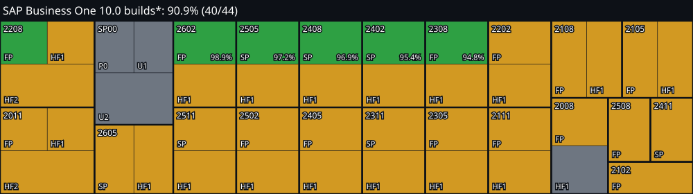
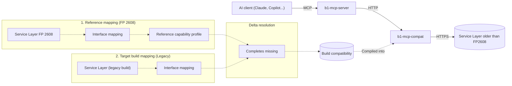

<div align="center">
  

  # b1-mcp-compat

  **Interoperability layer to use the SAP Business One MCP server with Service Layer versions older than 10.0 FP2608**

  [](https://dotnet.microsoft.com/)
  [](https://nodejs.org/)
  [](LICENSE)

  [Why](#why) | [How it works](#how-it-works) | [Requirements](#requirements) | [Getting started](#getting-started) | [See it working](#see-it-working-with-github-copilot) | [Run from the console](#run-from-the-console-no-windows-services) | [Agent instructions](#agent-instructions)
</div>

<br>

SAP ships an open-source [MCP server](https://help.sap.com/docs/SAP_BUSINESS_ONE/bb89a9939c294f14a7f532f7e76ade9e/9bdaeca12a424e6f9e3a0f4354651829.html?locale=en-US) that lets AI agents read and write Business One through the Service Layer. It only works with **10.0 FP2608 or later**. 

If your partner maintains its own variant of the SAP official MCP server, the compatibility connector works with it as long as the core keeps talking to the Service Layer the same way.

### Supported builds
<!-- coverage:start -->



<!-- coverage:end -->

Support applies to an exact build, not to a whole release.

## Why

Most Business One customers will not be on FP 2608 any time soon. This project closes that gap so AI can reach B1 data today, on the version customers already run.

- **A clean exit.** The connector is built to disappear. When a customer upgrades to FP 2608, it passes everything through untouched, and the customer is left with the standard setup, not an ad hoc layer bent around old versions.

When a customer asks their partner to connect AI to Business One, the answer should not be a bespoke integration. The standard MCP server, running on the release they already have, is the better answer.

## How it works

The official SAP MCP server depends on Service Layer features unavailable in versions prior to FP 2608. The connector sits between the MCP server and your Service Layer to fill in what is missing.



> [!IMPORTANT]
> **b1-mcp-compat does not include, copy, redistribute or reimplement any SAP software, code, schema or documentation, and it is not a substitute for any SAP product.** It only translates between the MCP server and the Service Layer you already run, under your own SAP license. The work behind it is limited to what interoperability requires: the interface facts a client needs to call the Service Layer, which older builds do not publish in usable form. What is gathered is used for that and nothing else.

1. **Reference mapping.** A one-time look at how FP 2608, the first release to natively ship annotated $metadata, describes its own interface through the METADATA resource (tables, columns, labels, valid values), so the connector knows what a client can call.
2. **Build mapping.** The same look at each legacy Business One build, to record which parts of that interface it supports and where it differs.
3. **Delta resolution.** Compares each legacy build with the FP 2608 reference and fills in what the older build lacks, handling legacy-specific behaviors. The output is a complete, build-specific compatibility profile compiled into the connector.

Each build's metadata is compiled into the connector. At run time the connector only reads it, so it needs no access to the disk of the Service Layer server.


## Requirements

> ⚠️ **Linux and SAP HANA are not supported yet.**

- **Windows Server 2016 or later** (or Windows 10 or later), with PowerShell 5.1+. The guide below is written for Windows.
- [.NET 10 SDK](https://dotnet.microsoft.com/download), only on the machine where you build the connector. The published exe is self-contained and needs no .NET on the server.
- [Node.js 22+](https://nodejs.org/), SAP `b1-mcp-server` is a Node.js application. The connector itself does not use Node.

#### SQL Server read permission

The connector needs read access to the company database. These are the only queries it runs, all read-only, taken from the FP 2608 reference profile:

```sql
SELECT OBJECT_ID('OPFS')
SELECT AbsEntry, TableName, FieldName, RefObjType, Category, OrigType, Type FROM OPFS
SELECT TABLE_NAME, COLUMN_NAME FROM INFORMATION_SCHEMA.COLUMNS WHERE TABLE_NAME LIKE '@%'
```

Results are cached for 5 minutes, so a burst of MCP requests costs at most one query every 5 minutes.

## Getting started

> To try it from a console instead without installation, see [Run from the console](#run-from-the-console-no-windows-services). 

### 1. Clone the repository

```powershell
git clone <repo-url> b1-mcp-compat
cd b1-mcp-compat
```

### 2. Add the MCP server (optional)

> Do this step only if you are starting from scratch with SAP `b1-mcp-server`. If you already have a variant of SAP base project, skip it and follow the rest of the guide as written. The only change on your side is a few environment variables, listed in [step 5.1](#51-configure-the-mcp-server).

This project ships **without** the MCP server. To start from scratch, put SAP `b1-mcp-server` in a folder named `b1-mcp-server/` at the root of the clone. The folder is git-ignored, so it never ends up in a commit.

1. Download `b1-mcp-server.zip` from the [SAP Business One help portal](https://help.sap.com/docs/SAP_BUSINESS_ONE/bb89a9939c294f14a7f532f7e76ade9e/9bdaeca12a424e6f9e3a0f4354651829.html?locale=en-US).
2. Unpack it so that this file exists: `b1-mcp-compat/b1-mcp-server/package.json`.

### 3. Build 

Many companies don't let you run executables someone else compiled. That's why there is no download here, build from source, so what runs on your server is code you understand.

It is recommended to put both services in the same folder, `C:\Program Files\b1-mcp`.


```powershell
# 1. Build b1-mcp-compat: self-contained single-file exe, no .NET needed on the target machine
dotnet publish compat/src/B1.Mcp.Compat.Host -c Release -r win-x64 --self-contained -p:PublishSingleFile=true -o "C:\Program Files\b1-mcp\compat"

# (only if starting from scratch) -> 2. Build b1-mcp-server: SAP own build steps, then copy the folder
cd b1-mcp-server
npm install --legacy-peer-deps
npm run build
cd ..
New-Item -ItemType Directory -Force "C:\Program Files\b1-mcp\b1-mcp-server" | Out-Null
Get-ChildItem b1-mcp-server -Force -Exclude .git, logs | Copy-Item -Destination "C:\Program Files\b1-mcp\b1-mcp-server" -Recurse -Force
```

### 4. Install the connector as a service

The connector (b1-mcp-compat) is already a Windows service, so the built-in `New-Service` is all it needs. No wrapper, nothing to download.

> This step has eight parts. In **4.1 to 4.7** you paste, in a **PowerShell opened as administrator**, the snippets that fit your needs.

---

#### 4.1 Choose the service account


<u>Option A (recommended):</u> a gMSA (group-managed service account). Windows manages its password, so there is none to store or rotate. It needs a domain, so without one use Option B. This assumes your IT team has already created it and allowed this machine to use it (see Microsoft's [gMSA overview](https://learn.microsoft.com/en-us/windows-server/security/group-managed-service-accounts/group-managed-service-accounts-overview)). A gMSA is written with a trailing `$`:

```powershell
$domain   = 'CORP'
$user     = 'sampleB1mcpGMSA$'
$account  = "$domain\$user"
$password = ''                    # a gMSA has no password to give

# Check that this machine can use it. It needs the *Active Directory module for Windows PowerShell*:
Test-ADServiceAccount $user.TrimEnd('$')
```

If it prints `False`, or errors, ask your IT team to add this machine to the gMSA's allowed computers, restart it, and run the check again.

<u>Option B:</u> an account you already have. Any domain account, or a local account:

```powershell
$domain   = 'CORP'                # '' for a local account
$user     = 'sampleB1mcpUser'
$account  = if ($domain) { "$domain\$user" } else { ".\$user" }
$password = [Net.NetworkCredential]::new('', (Read-Host -AsSecureString "Password for $account")).Password

#Check the account exists and the password is right. It must print `OK`:
Add-Type -AssemblyName System.DirectoryServices.AccountManagement
$ctx = if ($domain) { [DirectoryServices.AccountManagement.PrincipalContext]::new('Domain', $domain) } else { [DirectoryServices.AccountManagement.PrincipalContext]::new('Machine') }
if ($ctx.ValidateCredentials($user, $password)) { 'OK' } else { 'Wrong user name or password' }
```

*If the service later fails to start with "logon failure", grant that right in `secpol.msc`

---

#### 4.2 Give the connector read access to SQL Server

<u>Option A (recommended):</u> Windows authentication. The account from the previous step connects to SQL Server, the connector needs no extra setting. Nothing to paste here.

<u>Option B:</u> SQL login (user and password). If your policy prefers a SQL login, the service account needs no SQL permissions. Its password is asked for now:

```powershell
$sqlPassword = [Net.NetworkCredential]::new('', (Read-Host -AsSecureString 'Password for the SQL login')).Password
$sqlVars = @(
  'B1McpCompat__Database__User=sqlb1compat'
  "B1McpCompat__Database__Password=$sqlPassword"
)
```

---

#### 4.3 Connect to the database

Set where the company databases are:

```powershell
$dbVars = @(
  'B1McpCompat__Database__Server=localhost'
  'B1McpCompat__Database__Provider=SqlServer' # SqlServer (Hana is not supported yet)
  'B1McpCompat__Database__TrustServerCertificate=true'
)
```

---

#### 4.4 Connect to the Service Layer

Set where your **real** Service Layer is:

```powershell
$slVars = @(
  'B1McpCompat__ServiceLayer__Url=https://localhost:50000'   
  'B1McpCompat__ServiceLayer__SkipTlsVerify=true'           # accept the self-signed certificate of the Service Layer
)
```

---

#### 4.5 Check B1 release and build

Declare the release and build of your Service Layer. Run `tools/collect/check-build.ps1` on the Service Layer server and copy the values it prints:

| Setting | Default | Example | What it is |
|---|---|---|---|
| `B1McpCompat__Release` | empty | `2608` | Release of your Service Layer (`2208`, `2408`, `2608`; `FP` prefix allowed). Empty: taken from the `Login` version |
| `B1McpCompat__Build` | empty | `10.0.340.0-d02489c511c7-7e3e810900f1-fe64a1a2b194` | Build id printed by `tools/collect/check-build.ps1`. Empty counts as an unsupported build |

```powershell
$releaseVars = @(
  'B1McpCompat__Release=2608'
  'B1McpCompat__Build=10.0.340.0-d02489c511c7-7e3e810900f1-fe64a1a2b194'
  # 'B1McpCompat__AllowUnsupportedBuild=true'   # serve the knowledge base of the same release for a build that is not covered, with a warning and unverified
)
```

---

#### 4.6 Configure the log (optional)

It is not recommended to leave the logs on the C drive. Choose your own folder, writable by the service account from 4.1:

```powershell
$logVars = @(
  'B1McpCompat__Log__Path=D:\logs\b1-mcp'
)
```

If you are fine with the default, skip this step: the log goes next to the executable.

---

#### 4.7 Choose how the connector listens (optional)

 <u>Option A (recommended when both run on the same server):</u> plain HTTP on the loopback address. Nothing leaves the machine, so no certificate is needed:

```powershell
$tlsVars = @(
  'B1McpCompat__Listen=http://127.0.0.1:50300'
)
```

<u>Option B:</u> HTTPS. Use it if the MCP server runs on another machine or your policy requires encryption. You provide the certificate as a PFX file:

```powershell
$pfxPassword = [Net.NetworkCredential]::new('', (Read-Host -AsSecureString 'Password of the PFX')).Password
$tlsVars = @(
  'B1McpCompat__Listen=https://0.0.0.0:50100'
  'B1McpCompat__Tls__CertificatePath=C:\ProgramData\b1-mcp\compat.pfx'
  "B1McpCompat__Tls__CertificatePassword=$pfxPassword"
)
```

If the certificate is not trusted by the MCP server's machine, the MCP server needs `AUTH_ALLOW_SELF_SIGNED=true` ([5.1](#51-configure-the-mcp-server)).

---

#### 4.8 Create and start the service

Join the variables:

```powershell
$name = 'b1-mcp-compat'
$vars = @(@() + $sqlVars + $dbVars + $slVars + $releaseVars + $logVars + $tlsVars | Where-Object { $_ })
```

Run the snippets below in order, in the same PowerShell window. The service is only started at the end.

**Check the connection to SQL Server and the Service Layer.**

```powershell
.\tools\collect\check-connection.ps1 -Vars $vars
```

**Register the service.** Creates a Windows service that starts automatically with the machine and points to the connector executable:

```powershell
New-Service -Name $name -DisplayName $name -StartupType Automatic -BinaryPathName '"C:\Program Files\b1-mcp\compat\B1.Mcp.Compat.Host.exe"'
```

**Set the account the service runs as.** The account from 4.1 (for a gMSA the password is empty):

```powershell
sc.exe config $name obj= $account password= $password
```

**Write the settings.** Stores the variables as the service's own environment, in the registry. They are only visible to this service:

```powershell
$key = "HKLM:\SYSTEM\CurrentControlSet\Services\$name"
Set-ItemProperty $key -Name Environment -Value $vars -Type MultiString
```

**Restrict the registry key to administrators.** Removes every existing permission on the key and leaves only Administrators and SYSTEM, so nobody else can read the settings (they can contain passwords):

```powershell
$acl = Get-Acl $key
$acl.SetAccessRuleProtection($true, $false)     # stop inheriting, drop inherited rules
$acl.Access | ForEach-Object { $acl.RemoveAccessRule($_) } | Out-Null
foreach ($id in 'BUILTIN\Administrators', 'NT AUTHORITY\SYSTEM') {
  $acl.AddAccessRule((New-Object Security.AccessControl.RegistryAccessRule($id, 'FullControl', 'ContainerInherit,ObjectInherit', 'None', 'Allow')))
}
Set-Acl $key $acl
```

**Start the service and clear the passwords from memory.**

```powershell
Start-Service $name
Remove-Variable password, sqlPassword -ErrorAction SilentlyContinue
```

If `Start-Service` fails with error (logon failure), the account lacks the right to run as a service, add it under `secpol.msc`.

### 5. Set up the MCP server

This project works with SAP `b1-mcp-server` and with partner variants customized from it. SAP describes its server as a sample and a starting point, not necessarily production ready, so many partners adapt it and deploy it their own way. This guide does not try to replace that.

- **5.1 Configure it** is the only required part. It lists the environment variables that make the MCP server use the connector. If you already have your own customized MCP server and your own deployment, do just this one.
- **5.2 Run it as a service** is a suggestion for when you start from scratch with SAP server and have no deployment of your own. It shows one way to run it as a Windows service. It is a sample deployment of the base MCP server that SAP publishes. That server lacks some features, for example multi-tenancy, but it is a good starting point: adapt it to your own needs.

#### 5.1 Configure the MCP server

The MCP server must send its requests to the connector, not to the real Service Layer. Each partner defines the server's variables in their own way; [5.2](#52-run-it-as-a-windows-service-suggested) shows our recommended approach. If your variant is customized, check that it reads the same names, or adjust them.

**Settings the connector requires.** Only these two settings depend on the connector:


| Setting | Value | Notes |
|---|---|---|
| `SERVICE_LAYER_ROOT_URL` | `http://127.0.0.1:50300` | **The key setting.** The address of the connector (`B1McpCompat__Listen`), not of the real Service Layer. The real address goes to the connector |
| `AUTHENTICATION_MODE` | `direct` | The connector supports direct login only |

<br>

**Your usual configuration.** Everything else is the MCP server's normal setup. The connector does not change it:


| Setting | Notes |
|---|---|
| `B1_COMPANY_DB` | Passed through to the real Service Layer |
| `B1_USERNAME` | Passed through to the real Service Layer |
| `B1_PASSWORD` | Passed through to the real Service Layer |
| `HTTPS_ENABLED` | As fits your needs |
| `AUTH_ALLOW_SELF_SIGNED` | As fits your needs |
| `PORT` | As fits your needs |

#### 5.2 Run it as a Windows service (suggested)

Skip this if you already deploy the MCP server your own way. Otherwise, this is a recommended setup.

> **Note:** this is a sample of how to deploy the base version of the MCP server that SAP publishes. That version lacks some features, for example multi-tenancy, but it is a good starting point. Adapt both this setup and the `b1-mcp-server` itself to your own needs.

The goal of this deployment is to be as symmetrical as possible with the connector ([4.8](#48-create-and-start-the-service)): both run as Windows services in the same way, so they are installed and managed alike. [WinSW](https://github.com/winsw/winsw) is used as the service wrapper, and the settings are stored as the service's environment in the registry.

**1. Install the wrapper.** Download `WinSW-x64.exe`, save it as `C:\Program Files\b1-mcp\b1-mcp-server.exe` and save this definition next to it as `b1-mcp-server.xml`. It holds no settings, only how to start Node and the dependency on the connector:

```xml
<service>
  <id>b1-mcp-server</id>
  <name>b1-mcp-server</name>
  <executable>node</executable>
  <arguments>dist/index.js</arguments>
  <workingdirectory>C:\Program Files\b1-mcp\b1-mcp-server</workingdirectory>
  <depend>b1-mcp-compat</depend>
</service>
```

**2. Install it and set the account.** The same account as the connector (4.1; for a gMSA the password is empty):

```powershell
$name = 'b1-mcp-server'
& 'C:\Program Files\b1-mcp\b1-mcp-server.exe' install
sc.exe config $name obj= $account password= $password
```

**3. Write the settings.** WinSW is the service and Node is its child, so Node inherits the environment stored in the registry:

```powershell
$mcpVars = @(
  'SERVICE_LAYER_ROOT_URL=http://127.0.0.1:50300'
  'AUTHENTICATION_MODE=direct'
  'HTTPS_ENABLED=false'
  'PORT=3000'
  'B1_COMPANY_DB=COMPANYDB'
  'B1_USERNAME=svc_mcp'
  "B1_PASSWORD=$mcpPassword"
)
$key = "HKLM:\SYSTEM\CurrentControlSet\Services\$name"
Set-ItemProperty $key -Name Environment -Value $mcpVars -Type MultiString
```

**4. Restrict the registry key and start the service.** Same as the connector, only Administrators and SYSTEM keep access, since the key holds the password.

```powershell
$acl = Get-Acl $key
$acl.SetAccessRuleProtection($true, $false)
$acl.Access | ForEach-Object { $acl.RemoveAccessRule($_) } | Out-Null
foreach ($id in 'BUILTIN\Administrators', 'NT AUTHORITY\SYSTEM') {
  $acl.AddAccessRule((New-Object Security.AccessControl.RegistryAccessRule($id, 'FullControl', 'ContainerInherit,ObjectInherit', 'None', 'Allow')))
}
Set-Acl $key $acl
Start-Service $name
Remove-Variable mcpPassword, password -ErrorAction SilentlyContinue
```

To change a value later, an administrator edits the `Environment` value of that key and restarts the service.

### 6. Test the installation

First check that both services are up:

```powershell
Get-Service b1-mcp-compat, b1-mcp-server
```

Both must be `Running` (if you run the MCP server another way, check that it is up).

The following script checks the handshake, the tools and a few schemas.

<u>Option A. You started from scratch with SAP `b1-mcp-server`</u> (the one from step 5.2, on `http://localhost:3000/mcp`):

```powershell
.\tools\e2e\check-installed.ps1 -McpUrl http://localhost:3000/mcp
```

<u>Option B. You already have your own MCP server.</u> Pass its address. There is no `b1-mcp-server/node_modules` to borrow the MCP SDK from, so install it once in `tools/e2e`:

```powershell
cd tools\e2e
npm install @modelcontextprotocol/sdk
.\check-installed.ps1 -McpUrl http://HOST:PORT/mcp
```

## See it working with GitHub Copilot

<!-- Screenshots of connecting an MCP client (GitHub Copilot) to the server go here. -->

## Run from the console

For working on the connector, or to try it without installing any Windows service.

You need the [requirements](#requirements) first.

1. **Clone the repository.**

   ```powershell
   git clone <repo-url> b1-mcp-compat
   cd b1-mcp-compat
   ```

2. **Save your credentials (once).** Saves them encrypted for your Windows user, for local development only.

   ```powershell
   .\tools\dev\set-credentials.ps1
   ```

3. **Start the connector.** Leave this window open; after a code change, stop it with Ctrl+C and start it again. The release and build of your Service Layer are required: run `tools\collect\check-build.ps1` on the Service Layer server ([4.5](#45-check-b1-release-and-build)) and pass what it prints. Without `-Build` the script stops.

   ```powershell
   .\tools\dev\dev.ps1 -Release 2608 -Build 10.0.340.0-d02489c511c7-7e3e810900f1-fe64a1a2b194
   ```

   For a build that is not covered, add `-AllowUnsupportedBuild` (served unverified, with a warning).

   Wait until it reports it is listening on `http://127.0.0.1:50300` (check with `Test-NetConnection 127.0.0.1 -Port 50300`) before starting the MCP server.

4. **Start the MCP server**, in another window. Choose the case that fits you:

   <u>A. You start from scratch.</u> Put SAP `b1-mcp-server` in a `b1-mcp-server/` folder at the repo root ([step 2](#2-add-the-mcp-server-optional)). Build it once, set the [settings of step 5.1](#51-configure-the-mcp-server) in the window and run it:

   ```powershell
   cd b1-mcp-server
   npm install --legacy-peer-deps
   npm run build

   $env:SERVICE_LAYER_ROOT_URL = 'http://127.0.0.1:50300'
   $env:AUTHENTICATION_MODE   = 'direct'
   $env:B1_COMPANY_DB         = 'YOUR_COMPANY_DB'
   $env:B1_USERNAME           = 'YOUR_USER'
   $env:B1_PASSWORD           = Read-Host 'YOUR_PASSWORD'
   $env:HTTPS_ENABLED         = 'false'
   $env:PORT                  = '3100'
   $env:MCP_ALLOWED_HOSTS     = 'localhost:3100,127.0.0.1:3100'   # must include the port: it is compared with the Host header
   $env:NODE_TLS_REJECT_UNAUTHORIZED = '0'   # local only: accepts the Service Layer self-signed or expired certificate
   node dist\index.js
   ```

   Point any MCP client at `http://localhost:3100/mcp`, or try it with `npx @modelcontextprotocol/inspector`.

   <u>B. You already have your own MCP server.</u> Run it your own way and configure it as described in [step 5.1](#51-configure-the-mcp-server).

<br>
<br>
<br>
<br>


**AI-friendly.** You can ask an AI agent to setup this project for you. It follows the instructions below and guides you step by step.

<!-- BEGIN AGENT INSTRUCTIONS. Audience: LLM agents (Claude Code, Copilot, Codex, any other). Humans: nothing below is needed to install the project. -->

## Agent instructions

- **Trigger:** the user asks you to install or run this project.
- **Source of truth:** this README. Take every command from it verbatim; this section sets only the order and the questions.

**Protocol**

- Open each step with a short heading and a one-line result, so the user always knows where they are.
- At every decision (an optional step, any "Option A/B/C"): explain the options briefly, recommend one, ask one question per turn, wait for the answer before continuing.

**Steps**

1. **Requirements.** Ask permission, then run read-only version checks for everything in [Requirements](#requirements) (OS, PowerShell, .NET 10 SDK, Node.js 22+, git). Done when: every item has a version or a "missing" result, and the user has fixed all that are missing.
2. **Mode.** Ask: Windows services ([Getting started](#getting-started)) or console ([Run from the console](#run-from-the-console-no-windows-services)). For services, check that the shell is elevated. Done when: the mode is chosen (and, for services, the shell is elevated).
3. **Exact build.** The connector needs the exact Business One build: the Service Layer reports only its release, and the compatibility data is extracted per exact build ([Check your build](docs/guides/check-your-build.md)). Ask permission to run `tools/collect/check-build.ps1` (read-only, no credentials); ask for the Service Layer folder path if the default is wrong, or have the user run it on the Service Layer server and paste the output. If the build is not covered, present the two options in that document and let the user choose. Done when: release and build id are known and the build is covered, or the user has chosen an option for an uncovered build.
4. **Install or run.** Follow the chosen path of this README in order, stopping at each decision. The user runs the final install command ([4.8](#48-create-and-start-the-service)) themselves in an elevated PowerShell: show it complete, exactly as it will run, with every variable filled in and secrets replaced by a prompt (`Read-Host -AsSecureString`). Run it yourself only if the user explicitly asks. Done when: the user confirms the command ran (services), or the console path's last command is running (the console path's `dev.ps1` takes the release and build from step 3, never run it without them).
5. **Verify.** Do [Test the installation](#6-test-the-installation). Done when: the test passed, or every failure is reported with its log path; then list what is left for the user to do.

<!-- END AGENT INSTRUCTIONS -->
