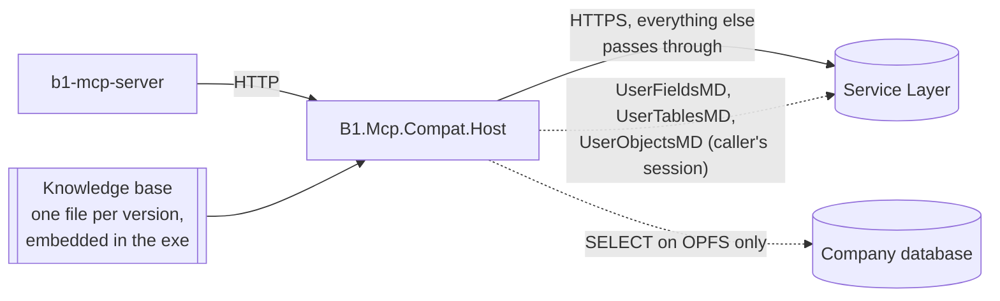

# B1.Mcp.Compat

Interoperability layer (HTTP connector, .NET 10) that sits between SAP's **b1-mcp-server** and a Service Layer older than 10.0 FP2608, so the MCP server works unmodified. Against an FP2608+ Service Layer it is transparent.



> [!NOTE]
> The exe embeds one knowledge base per verified release (`kb-2208/2408/2608.json.gz`) and chooses by the release and build the administrator declares (`B1McpCompat__Release`, `B1McpCompat__Build`; see [Versions and builds](#versions-and-builds)).

## What it answers on behalf of the old Service Layer

| Request | Source of the answer |
|---|---|
| `GET /b1s/v2/$metadata?scope=entityset&annotation=…` | The Service Layer's own plain `$metadata`, plus annotations. **Standard** objects: the knowledge base. **Customer-defined** ones (user fields, user tables, user objects): the Service Layer's `UserFieldsMD`, `UserTablesMD` and `UserObjectsMD`, read with the caller's session |
| `POST /b1s/v2/PersonalFieldsSetupsService_GetPersonalFieldsByTable` | The company's `OPFS` table, selected exactly like the native action (see [Personal data](#personal-data)) |
| `GET /b1s/v2/<Set>`, `<Set>(key)`, `<Set>/$count` of a set that the Service Layer does not expose | The company database, planned from the embedded **read package** of the exact build (`Resources/read-<package>.json.gz`; see [Extended read](#extended-read)). `POST`/`PATCH`/`DELETE` on those sets: refused (read only) |
| Anything else | Passed through untouched (cookies, bodies, status) |

Unresolved cases follow the native Service Layer where that is verified: a user field (`U_`) missing from the user catalog of a known table is left out, like the native engine does; an enum member without a stored value is served without `ValidValue`. If a standard property is in neither the knowledge base nor the override file, or a user-table column or child is not explained by the catalog, that entity set alone fails with HTTP 502 naming the property and the line to add to `mappings.override.json` (native behaviour not verified for those; nothing is guessed). The personal-data action fails closed.

## The standard dictionary

The part of the annotation that is SAP-standard (what is behind `BusinessPartners.CardCode`: label "BP Code", table `OCRD`, column `CardCode`) is not asked from any system at run time. It is a **knowledge base**: a JSON file, one per Service Layer version, generated beforehand and embedded in the exe.

### Where it comes from

Data comes from per-build compatibility profiles produced by interface mapping. A version is *verified* when its profile was checked against that exact build.

## Where the knowledge lives

| What | Where | Changes when |
|---|---|---|
| SAP-standard dictionary: labels, tables, columns, child tables, enum values | `src/B1.Mcp.Compat.Host/Resources/kb-<version>.json.gz`, embedded in the exe | A new Service Layer version is added |
| Table the native personal-data action asks `OPFS` for | `src/B1.Mcp.Compat.Core/Personal/pf-map-<release>.json`, embedded, one per release, generated by the maintainer tooling from that release | Never within a version (997 exceptions; every other table maps to itself with category `N`; FP2208 differs from FP2408/FP2608 in 10 fiscal-invoice tables) |
| Which knowledge base serves a session | `B1McpCompat__Release`, `B1McpCompat__Build`, `B1McpCompat__AllowUnsupportedBuild` (environment) compared with the `build` block of each knowledge base | The administrator declares the release and build of the Service Layer ([Versions and builds](#versions-and-builds)) |
| Manual fixes for one installation | `mappings.override.json` next to the exe | An administrator resolves a 502 |
| User fields, tables, objects; personal-data rows | Read at run time from the Service Layer and from `OPFS`; cached 5 minutes per company | Never stored |

The knowledge base never contains anything a customer defined. What it is made of is explained in [The standard dictionary](#the-standard-dictionary).

### Versions and builds

A version is **verified** only when its dictionary was mapped from that build and the result was checked. The Service Layer cannot say which build it is: the `Login` answer has only `Version` (`1000200` FP2208, `1000260` FP2408, `1000340` FP2608), the same for every patch level. So **the administrator declares the release and the build** with `B1McpCompat__Release` and `B1McpCompat__Build`, and the connector loads the knowledge base that matches them. Nothing is detected or inferred.

- **Build id**: an opaque value that identifies the exact build, for example `10.0.340.0-d02489c511c7-7e3e810900f1-fe64a1a2b194`. `tools/collect/check-build.ps1` prints the exact `B1McpCompat__Release` and `B1McpCompat__Build` to copy; the connector compares the id with the `build` block of each embedded knowledge base ([covered builds](../docs/supported-builds.md); what was and was not checked per build: [build notes](../docs/build-notes.md)).
- **Supported** (declared build equals the build of the knowledge base of the release): served as verified.
- **Not supported** (build differs or is not declared, or the release has no knowledge base): metadata requests and the personal-data action fail with HTTP 502 and a fixed message that says to generate the knowledge base for that build (contact the maintainer with the output of `check-build.ps1`) and names `B1McpCompat__AllowUnsupportedBuild`.
- **`B1McpCompat__AllowUnsupportedBuild=true`**: a build that differs, or is not declared, no longer fails. The connector serves the knowledge base of the declared (or Login) release and logs once a warning with the declared build, the build of the knowledge base used and that it is not verified. A release without any knowledge base is an error whatever this says.
- **Consistency**: if the `Login` Version does not belong to `B1McpCompat__Release`, or `B1McpCompat__Build` is the build of another release, the answer is a 502 naming both, always (also with `AllowUnsupportedBuild`): the safe choice is to serve nothing. If `B1McpCompat__Release` is empty, the release is that of the `Login` Version.
- A wrong format of either parameter stops the connector at start. At start the connector logs whether the declaration is supported.

Personal-data and user-defined handling does not depend on the version. Details for the installer: [Check your build](../docs/guides/check-your-build.md).

### A new installation that is not verified

For a version or a patch level without a knowledge base (or when a 502 shows properties the dictionary lacks), the installer does not generate anything. The maintainer of this repository is the only one who generates knowledge bases; the installer contacts them.

1. **Check the Service Layer** gives the connector what it needs. From any Windows machine that reaches it:
   ```powershell
   cd tools\collect
   $env:B1_PASSWORD = '<Service Layer password>'
   .\check-upstream.ps1 -SlUrl https://SLSERVER:50000 -Company YOURCOMPANYDB -User manager -Tag 2502 -SqlServer SQLSERVER -SqlUser sa
   ```
   It must end in `READY`: `UserFieldsMD`, `UserTablesMD` and `UserObjectsMD` readable, their `U_*` fields equal to the plain `$metadata`, and (with `-SqlServer`) `OPFS` readable. Note the version code of the `Login` it prints.
2. **Run `tools/collect/check-build.ps1`** on the Service Layer server ([Check your build](../docs/guides/check-your-build.md)) and set the `B1McpCompat__Release` and `B1McpCompat__Build` it prints. If the result is `DISTINTA` or `NO CUBIERTA`, send its output to the maintainer; meanwhile `B1McpCompat__AllowUnsupportedBuild=true` serves the knowledge base of the same release, unverified.

## Extended read

Sets that exist only in newer Service Layers (and whose tables exist in the installed build) are read from the company database. Only `/b1s/v2`; `/v1` is always passthrough.

- **The package** is selected like the knowledge base (Login `Version` plus the declared `B1McpCompat__Build`), but only for the exact build it was generated from (`build.buildId` must equal the declared build). Without a package, for an unverified build, or for a session the connector did not see log in, nothing is intercepted: the request goes to the Service Layer as before.
- **A set is intercepted only if the Service Layer does not expose it**: its plain `$metadata` (the cached one of the metadata synthesis) lists neither the set nor any alias of it. If `$metadata` cannot be read, the request is passed through.
- **Database access** is the one of the personal-data feature (`B1McpCompat__Database__*`); only the SELECTs planned from the package are run, always parameterised. It does not apply the B1 authorizations of the user.
- A set whose table is missing in the build answers 400 naming the table. A shape without a measured rule answers 501 instead of being guessed.
- **Limitation: `$batch` is not intercepted.** A `$batch` is passed to the Service Layer, so an extended set read inside it fails there. Read extended sets with plain GET. What was and was not checked per build: [build notes](../docs/build-notes.md).

## Personal data

The native action never returns `OPFS` rows by the table you ask for. For a requested table `T` it runs `SELECT … FROM OPFS WHERE TableName = <abstract table> AND Category = <category>`:

| Requested table | Abstract table | Category |
|---|---|---|
| Any other (e.g. `OCRD`) | itself | `N` |
| Sales documents and their lines (`ORDR`, `OINV`, `ODLN`…) | `ODOC`, `DOC1`..`DOC28` | `R` |
| Purchasing documents (`OPOR`, `OPCH`…) | `ODOC`, `DOC1`..`DOC28` | `P` |
| `OPRQ` / stock transfers `OWTQ`, `OWTR` | `ODOC`, `DOC1`..`DOC28` | `Q` / `A` |
| Incoming / outgoing payments (`ORCT` / `OVPM`) | `OPMN`, `PMN1`..`PMN9` | `H` / `I` |
| Tax invoices | `OTXI`, `TXI1`..`TXI4` | `J` / `K` |
| Opportunities, equipment cards, landed costs, payment results | their own | `C`, `E`, `L`, `X` |

This was observed on an FP2608 by capturing the engine's own SQL for all 3053 dictionary tables, and reproduces the native rows exactly in all of them. The categories `B D F G M O S U Y` are never queried, so their rows are never returned (for `OCRD`, 93 of its 95 `OPFS` rows). Row order is not fixed natively (it varies between Service Layer nodes), so do not depend on it.

## Projects

| Project | Role |
|---|---|
| `B1.Mcp.Compat.Core` | Model and decisions, no I/O: `Kb/` knowledge base, `Catalog/` user catalog and system columns, `Metadata/` synthesis, `Personal/` OPFS mapping, `Mappings/` overrides, `Edm/` model parser |
| `B1.Mcp.Compat.Data` | Reads `OPFS`: SQL Server (Microsoft.Data.SqlClient). SAP HANA is an **experimental, untested stub** |
| `B1.Mcp.Compat.Host` | Kestrel proxy, configuration, logging; `ProxyEndpoint` routes the three request kinds |

## How a metadata request is resolved

`MetadataSynthesizer` starts from the plain `$metadata` of the Service Layer and, for each property of the requested entity, takes the first match (there is no guessing):

1. `mappings.override.json`
2. The knowledge base (a `null` fact means "exists but the native Service Layer does not annotate it", so the property is left out like the native one does)
3. A user field of a standard table: `(table, U_alias)` in `UserFieldsMD`
4. A user table or object: a system column of the table type (`Code`, `Name`, `DocEntry`, `LineId`…, see `SystemColumns`) or one of its user fields; child tables of a user object come from `UserObjectMD_ChildTables`

Anything else makes that entity set fail with `UnresolvedMappingException`, except the two cases above (U_ field not in the catalog: omitted; enum member without value: no `ValidValue`). The result mirrors the native FP2608 response: for the same entity set the annotations are identical, only the XML ordering differs.

Other behaviours worth knowing:

- **Company:** the connector learns which company a session belongs to from the `CompanyDB` of the `POST /Login` that passes through, so clients must log in through it (direct login only; OAuth/Keycloak is not supported).
- **Caches:** plain `$metadata` 10 min, user catalog 5 min and `OPFS` 5 min, per company. Failures are never cached.
- **Native upstream:** if the Service Layer already answers the annotated `$metadata`, the connector passes everything through (detected once).
- **Complex or collection properties without a table mapping** are omitted, as the native `$metadata` does.

## Configuration

Environment variables `B1McpCompat__Section__Key`; there is no settings file. Every key has a default.

| Key | Default | |
|---|---|---|
| `Listen` | `http://127.0.0.1:50300` | Listener. `https://…` requires `Tls:CertificatePath` (a PFX you provide; the connector does not generate certificates) |
| `Release` | empty | Release of the Service Layer, declared: `2208`, `2408` or `2608` (`FP` prefix allowed). Empty: the release of the Login `Version` |
| `Build` | empty | Build id printed by `tools/collect/check-build.ps1`. Empty: not declared, counted as unsupported |
| `AllowUnsupportedBuild` | `false` | `false`: a build without knowledge base is a 502 with a fixed message. `true`: serve the knowledge base of the release, with a log warning, not verified |
| `PageSize` | `20` | Page size of the extended reads (sets the native Service Layer lacks). Order: header `Prefer: odata.maxpagesize=N`, then `B1S-PageSize: N`, then this key. The `PageSize` key of the Service Layer `b1s.conf` is on another machine and the connector cannot read it: if the administrator changed it there, set the same number here (decision closed 2026-10-27; 20 is the native default) |
| `ServiceLayer:Url` / `SkipTlsVerify` | `https://localhost:50000` / `true` | The Service Layer (they ship self-signed certificates) |
| `Database:Provider` | `SqlServer` | `SqlServer` or `Hana` (experimental) |
| `Database:Server` | `localhost` | `host`, `host\instance` or `host,port`. The database is the `CompanyDB` of the Login |
| `Database:User` | empty | SQL login. Empty means Windows authentication (the account the process runs as) |
| `Database:Password` | empty | SQL password |
| `Database:TrustServerCertificate` | `true` | |
| `Database:ConnectionString` | empty | Advanced: a full connection string replacing the five settings above; `{CompanyDB}` is replaced by the Login's company |
| `Log:Path` | empty | Folder of the log files (`b1-mcp-compat-<date>.log`, 14 days kept). Empty: next to the exe. Unwritable: the connector does not start |
| `Log:Level` | `info` | `info` or `error`. JSON lines in the OpenTelemetry log data model, one wide event per request (method, path, status, duration, kind, company, user; never the password), `trace_id` taken from `traceparent` |
| `Mappings:OverridePath` | `mappings.override.json` | Manual mappings (see below) |
| `SimulateLegacy` | `false` | Test only: hide the native FP2608 features of the upstream, to check the connector against a native Service Layer |

`mappings.override.json`:

```json
{ "mappings": [
    { "entity": "Orders", "property": "SomeField", "table": "ORDR", "column": "SomeCol", "label": "Optional" },
    { "entity": "SomeEntity", "table": "OXYZ", "label": "Optional entity label" } ],
  "enums": [ { "enum": "BoSomeEnum", "member": "bo_X", "value": "X" } ] }
```

The 502 error prints the exact line to paste.

## Command line

```
B1.Mcp.Compat.Host [serve]     run the proxy (default)
B1.Mcp.Compat.Host version     version and the embedded knowledge base
```

## Develop

Requirements: .NET 10 SDK, Node.js 22+ for the tests that run the MCP server, PowerShell 5.1+.

```powershell
dotnet build compat -c Release
dotnet publish compat\src\B1.Mcp.Compat.Host -c Release -r win-x64 --self-contained -p:PublishSingleFile=true -o compat\publish
```

| To | Run |
|---|---|
| Run the connector from source | `tools\dev\set-credentials.ps1` once (saves a DPAPI-encrypted profile in `.dev\`), then `tools\dev\dev.ps1 [-SimulateLegacy]` |
| Compare against a native FP2608 | `tools\parity\run-parity.ps1`: MCP server → connector (simulating legacy) vs MCP server → native; the calls must be identical |
| Check every entity set on any installation | `tools\e2e\e2e.ps1 -SlUrl … -Company … -User … -Exe compat\publish\B1.Mcp.Compat.Host.exe` |
| Check a Service Layer before connecting it | `tools\collect\check-upstream.ps1` |

The most useful regression test is a native FP2608 with `SimulateLegacy=true`: the connector then has to reproduce, from the knowledge base and the user catalog, what the native Service Layer says.
